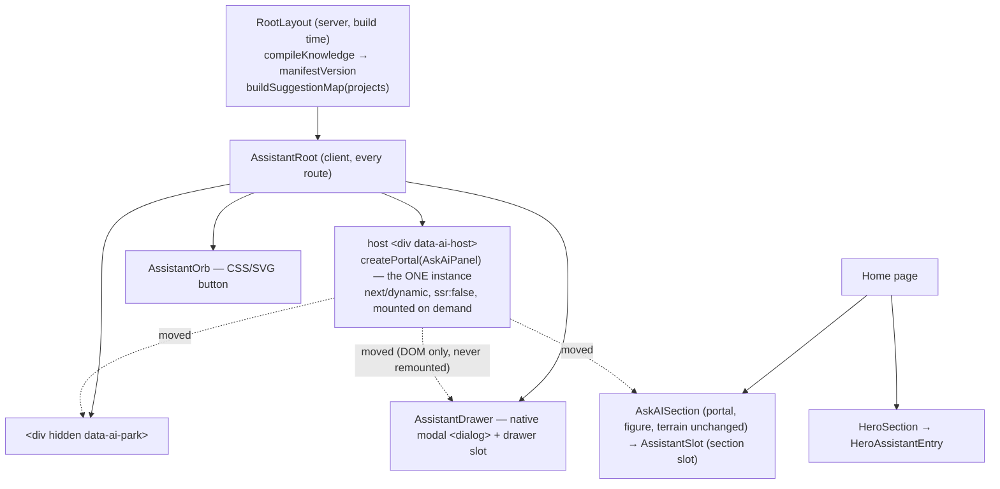

# AI Presence V1 — Architecture

One assistant, one conversation, reachable from everywhere. AI Presence adds **entry points**, not intelligence: the existing Ask My AI panel (Smart Mode + Local AI) stays the only assistant, mounted once for the whole site and shown wherever the visitor opens it.

## Constraints that shaped it

- **No second engine, knowledge base or chat UI.** The drawer, the hero entry and the Ask My AI section all show the same `AskAiPanel` instance.
- **Nothing heavy up front.** Every route ships only the orb, the drawer shell and a small store. The panel, the Smart index and the knowledge file load on demand. Local AI still needs the visitor's explicit consent, exactly as before.
- **Session memory only.** No conversation is stored. Reloading the page starts a new conversation; client-side navigation keeps it.

## Component map

| Piece | File | Role |
| --- | --- | --- |
| Store | `src/state/assistant-store.ts` | `open`, `shown` (drawer on screen, including its exit animation), `requested` (UI module wanted), `pending` question, `presence`, the two `slots`, `opener` |
| Root | `src/components/assistant/AssistantRoot.tsx` | Renders the one panel into a persistent host node and moves that node. Also the global shortcut |
| Drawer | `src/components/assistant/AssistantDrawer.tsx` | `<dialog>` shell: showModal/close, scroll lock, the 3D pause, focus in and out, closes on navigation |
| Orb | `src/components/assistant/AssistantOrb.tsx` | Floating entry point. Its phase follows the published presence |
| Section slot | `src/components/assistant/AssistantSlot.tsx` | The original panel position inside Ask My AI. Requests the UI module when within ~1200 px of the viewport |
| Hero entry | `src/components/assistant/HeroAssistantEntry.tsx` | "Meet my intelligence" call to action plus grounded suggestion chips |
| Suggestions | `src/components/ask-ai/suggestions.ts` | Route → grounded questions, built at build time from the projects list |
| Presence | `src/components/ask-ai/presence.ts` | Pure mapping from panel state to the orb phase |
| Panel hooks | `src/components/ask-ai/AskAiPanel.tsx` | Additive only: consumes a queued question once, publishes presence, shows route suggestions, keeps the newest answer in view |
| 3D pause | `src/state/experience-store.ts`, `src/experience/canvas/ExperienceCanvas.tsx` | `assistantOpen` joins `mediaOverlay` / `aiRenderHold`: the frame loop switches to `demand` while the drawer covers the world |

## The single-instance teleport

`AssistantRoot` creates one host `
` on the client and renders the panel into it with `createPortal`. A layout effect then attaches that node, before paint, to the first available target:

1. the **drawer slot**, while the drawer is on screen (`shown`);
2. otherwise the **section slot** (home page only);
3. otherwise the hidden **park**.

Moving a DOM node does not remount React components. The conversation reducer, the draft, the chosen mode, the Local AI worker and runtime, any stream in progress and the live-region announcements all stay in one place. The root layout persists across App Router navigations, so the instance does too.

When the home page unmounts, its section slot unregisters. The host node is detached with the slot and re-attached to the park before the next paint.

Two synchronised instances were rejected. They would duplicate the Smart index, could start a second Local AI worker, would announce answers twice, and would have required moving the panel's whole reducer out of the component.

## Opening with a question (hero chip)

1. Hover or focus calls `request()`, which starts loading the panel chunk.
2. A click calls `openAssistant({ question, opener })`. The store sets `open` and a `pending` question with a fresh id.
3. The drawer's layout effect runs `showModal()` and locks the page scroll. It sets `assistantOpen` (the 3D pause) and `shown`, which moves the host into the drawer.
4. The panel, once mounted, takes the question with `takePending(id)`, at most once per id. It asks the question, or puts it in the draft if a turn is already running, so it never starts a second concurrent turn.
5. Every panel state change publishes `presenceOf(state)`. Duplicates are dropped and progress is rounded to 1 %, so the orb re-renders on transitions only, never per token.
6. Closing (Escape, the close button, the backdrop, the shortcut, or navigation) plays the exit animation and then calls `dialog.close()`. The `close` event restores the page scroll, resumes the 3D loop, clears `shown` (the host goes back to the section or the park) and returns focus to the opener.

The `close` event is dispatched asynchronously, after the browser has already restored focus. A reopen can therefore land before it arrives. The handler ignores the event when the dialog is already open again, and a reopen keeps the page's original scroll value. A reopen during the exit animation simply plays the entrance again. All three cases are covered by an E2E test.

## Presence → orb phase

`presenceOf` checks, in priority order (first match wins):

| Panel state | Orb phase |
| --- | --- |
| Local model download in progress | `downloading` (+ progress ring) |
| Local model initialising | `initializing` |
| Local generation or a streaming turn | `generating` |
| Turn pending, Smart index loading, capability check | `retrieving` |
| Smart/local error, resource pressure, failed turn | `error` (quiet amber dot) |
| Answer delivered with a fallback notice | `fallback` (violet dot) |
| Answer delivered | `complete` (one glow) |
| Smart Mode ready | `ready` |
| Nothing loaded yet | `idle` |

## What loads when

| When | What |
| --- | --- |
| Every route, first load | Root, orb, drawer shell, store, shortcut and focus helpers. The suggestion map travels as props in the RSC payload |
| First of: orb or hero hover/focus, the section within ~1200 px, or opening | The `AskAiPanel` chunk (panel plus Smart engine code). On mount the panel fetches `/ai/knowledge.json`, as it always has |
| Only after the visitor consents in the panel | The Local AI runtime, worker and model, all unchanged |

**Trade-off.** The panel is no longer server-rendered inside the section. It mounts when the section comes within ~1200 px of the viewport, into a slot that reserves its space until it arrives. Nothing was lost by this: the panel has always needed JavaScript to answer, and the section's heading, copy and scene art are still server-rendered as before. Existing E2E specs that assumed the panel was present at page load now bring the section near first (`sectionPanel()` in `tests/e2e/helpers.ts`).

## What did not change

- No file under `src/lib/portfolio-ai/`, `src/lib/assistant/` or the content sources is modified. Grounding, refusals, prompt-injection handling, the Local AI consent flow and the absence of any cloud inference are therefore untouched.
- Smart Mode golden set: 76/76, refusals 17/17. The knowledge manifest version is unchanged (`k1bbb3bf6f1df`).
- The Ask My AI section keeps its portal, figure, terrain and panel: the panel now arrives through the section slot instead of a direct import.
- The panel's home-page suggestions are the same four questions as before; they moved from `copy.ts` to `suggestions.ts`.
